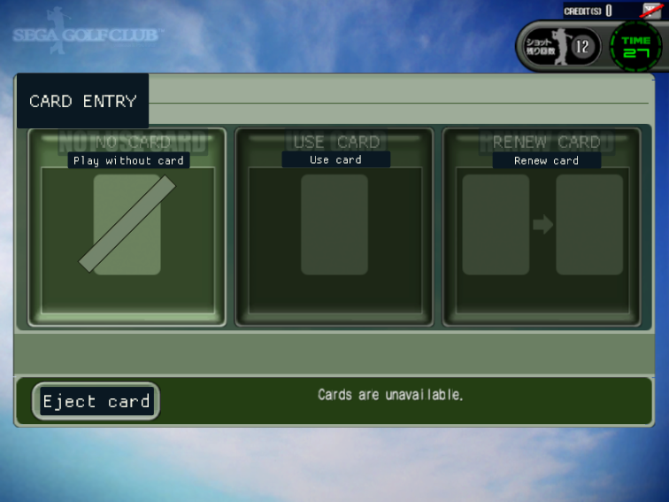
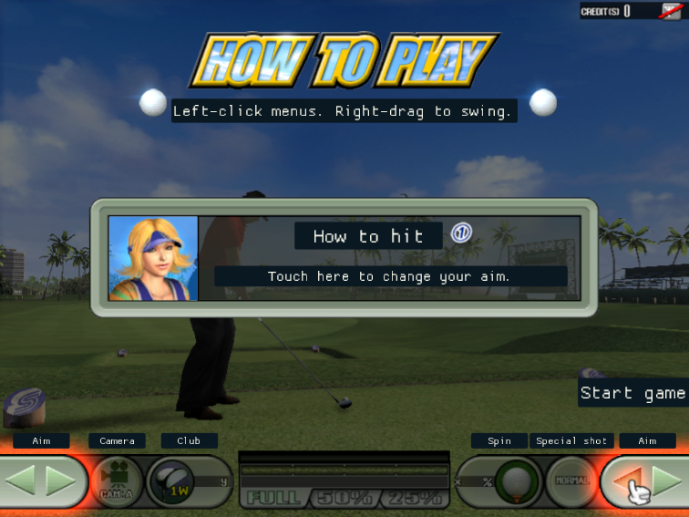
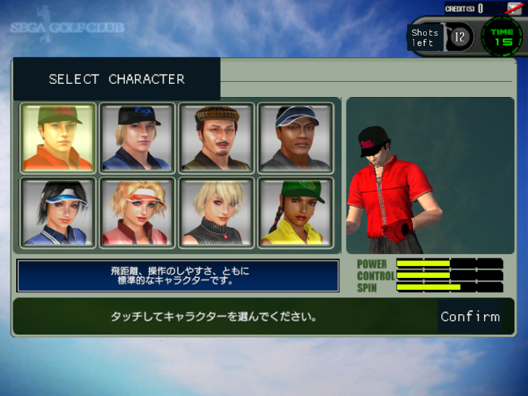
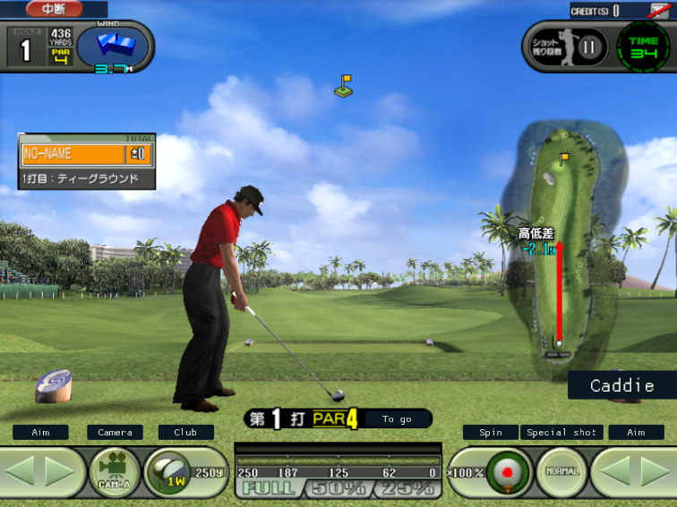

# Sega Golf Club native recompilation

Standalone experimental Sega Golf Club Network ProTour port, with its patched
XBERecomp runtime included. The supported local disc is GDX-0010B, V3.000,
dated 2004-10-14.
Native Linux boots the original server and satellite over a local link and
reaches Card Entry, character selection and the first hole's 3D course. Mouse
clicks and dragging operate the touch panel directly; right-mouse dragging
operates the cabinet's analog golf club. Controller and keyboard adapters
remain available. A mouse-driven shot has been verified through ball movement
and the next shot. A complete hole, sound fidelity and Android remain
unverified.

The first English interface pass is enabled by default: 66 messages and 243
sprite labels. Choose English or Japanese in the launcher, or use F10's
**Interface language** selector while playing. Some course commentary,
names, operator screens and artwork remain untranslated. See
[localization notes](localization/README.md) for coverage and editing.

| English card entry | Tutorial and mouse controls |
| --- | --- |
|  |  |
| Character selection | First-hole gameplay |
|  |  |

These are cropped screenshots from the native Linux port. English coverage is
partial: card entry, play modes, multiplayer prompts, common buttons, tutorial
instructions and selected gameplay controls are translated. Character names
and descriptions, course-specific caddie commentary, operator screens, voices
and some HUD artwork still use Japanese. The screenshots include those gaps.

The original game stores text both as Shift-JIS strings and as graphics in
sprite atlases. The port replaces selected strings in memory and places
English text panels over recognized sprite labels. It preserves the original
touch regions; the panels do not reproduce the original artwork's typography.
Switching languages restores the Japanese strings and hides the English
panels. Translation wording lives in [localization/en.json](localization/en.json);
see the [editing notes](localization/README.md) before adding entries.

Requires Linux x86-64, Python 3.11+, PyCryptodome for disc extraction, Clang,
LLD, CMake 3.25+, Ninja and Vulkan 1.3 development files/drivers. CMake uses an
installed SDL3 3.2+ or fetches SDL3; it also fetches the other pinned build
dependencies and the hash-checked Linux DXC distribution. See
[UPSTREAM.md](UPSTREAM.md) for runtime provenance and notices.

From this repository:

```sh
python3 tools/prepare_game.py "/path/to/Sega Golf Club - Network ProTour v3.000 (2004)(Sega)(JP).zip"
python3 tools/build_native.py --jobs 4 --tests
./run.sh
```

Running `./run.sh` on a desktop opens launch options for **1 or 2 players** and
**English or Japanese**. The options window uses the optional `zenity` program.
Your chosen setup is saved in `.local/launcher.json`. Without Zenity, the
launcher starts directly; the command-line options work in either case:

```sh
./run.sh --players 1 --language en  # One English player window
./run.sh --players 2 --language ja  # Two Japanese player windows
./run.sh --no-menu                 # Start with the saved setup
./run.sh --menu                    # Show the options window explicitly
```

An explicit `--language` takes precedence over `SEGAGOLF_LANGUAGE`; otherwise
that environment variable overrides the saved language. F10 changes language
for the current player window until the next launch. English remains a partial
translation; Japanese restores the original text and artwork.

The two-player setup opens Player 1 (main satellite,
`127.0.0.2`) and Player 2 (sub satellite, `127.0.0.3`). A third process runs
the original server at `127.0.0.1` in the background, using offscreen Vulkan
so it needs no visible game screen. Closing either player window stops all
three processes. Settings, logs and guest HDDs are separate under
`.local/linked/server/`, `.local/linked/main/` and `.local/linked/sub/`.
Use `./run.sh --players 1` for one playable cabinet, or `--show-server` to
display the server for diagnostics. The original server takes
about a minute to initialize; allow roughly 90 seconds for network discovery,
login and title startup. The link uses real TCP/UDP on loopback, including the
game's original discovery and login packets. External online services are
unavailable. A single direct executable launch retains the factory satellite
sub role and cannot supply the server it needs.

Click the player window you want to control. Each cabinet has its own coin
counter, touch panel and swing input. Start both players to use the game's
original local matchmaking; a full head-to-head round remains unverified.

Use either player window for play:

| Action | Mouse | Keyboard | Controller |
| --- | --- | --- | --- |
| Point at the touch panel | Move pointer | Arrow keys | Left stick or D-pad |
| Touch/hold, release to lift | Left-click / drag | Z / Space / W | A / right trigger |
| Backswing | Hold right button and pull down | Hold K (full power) | Pull right stick down |
| Forward swing | Push up while holding right button, or release | Release K | Return right stick |
| Fine cursor movement | — | Q / left Shift | Left trigger |
| Insert coin | — | Backspace | Back |
| Start | — | Enter | Start |
| Settings/resume | — | F10 | R3 |

The mouse points directly at the game image; clicks in the letterbox borders
are ignored. The system pointer replaces the virtual cursor during mouse use.
Keyboard/controller input retains a cyan cursor, orange when pressed. Touch input goes
through the original serial packet parser, including calibration, press/hold/
release states and checksums. Input releases when the window loses focus or
settings open. Keyboard bindings can be changed in the satellite's
`settings.toml`. Escape also closes the settings panel.

To swing, hold the right mouse button near the upper half of the game image
and pull down. About one third of the image height gives a full backswing;
shorter pulls select less power. Pause briefly at the desired backswing, then
push upwards to strike. Letting go also returns the club to its rest position.
This drives the original club sensor, power filter and swing timing through
JVS analog channel 3. Left-click remains the touch-panel control.

After startup, insert a coin with Backspace and left-click the title
screen. This adds a credit and enters Card Entry; the no-card option is on the
left. A complete hole has not yet been validated.

Audio uses the system's default output device. Startup can be quiet until the
title screen appears. If the game is silent, check the system output's mute
and volume controls; opening F10 pauses game audio along with play. Stereo
mixer output has been verified, while sound fidelity and DSP effects still
need validation.

Preparation requires PyCryptodome. It reads the zipped GDI/raw-sector dump,
extracts the 512 MB container, verifies the track's ZIP CRC, decrypts FATX and
writes the original game tree under `assets/`. It refuses to overwrite previous
outputs. Private manifests, containers, generated code and builds are ignored.
The build checks the exact `golf.xbe` SHA-256 before translating it.

The key is publicly documented in the
[Citylan dump notes](https://www.citylan.it/index.php/Sega_Golf_Club_Network_Pro_Tour_2005_(Rev_C)_(GDX-0010C)).
[MAME's Chihiro driver](https://github.com/mamedev/mame/blob/master/src/mame/sega/chihiro.cpp)
identifies the same security PIC for revisions B and C. Successful FATX
decryption was verified against the local revision B archive.

For CPU diagnostics, first build the native tools, then run from this port:

```sh
python3 tools/build_headless.py --jobs 4
timeout 30s ./out/harness/SegaGolf "$PWD/assets"
```

The headless renderer does not complete occlusion-query reports. The game
polls an empty query during graphics initialization before its first present,
so native Vulkan is required to progress past that point. Cabinet EEPROM,
backup memory and controller firmware buffers currently last only for the
running process. `golf_test.xbe` is extracted but has no translated target.

See [PORT_STATUS.md](PORT_STATUS.md) for identity, evidence and open work.

Validation from this port:

```sh
ctest --test-dir out/build/linux-release --output-on-failure
SEGAGOLF_TRACE_STARTUP=1 python3 tools/run_linked.py --seconds 150
```

Socket tests need permission to create local sockets. They verify real TCP/UDP
payload exchange, BSD socket addresses, asynchronous completion, DMA transfers
and readiness polling. Touch tests check cursor movement, packet checksums,
controller focus handling and the original serial command ABI. Swing tests
send SDL mouse gestures through the original analog decoder and swing filter,
checking backswing latching, forward strokes and the right-stick fallback.
An optional `-DSEGAGOLF_INPUT_SMOKE=ON` build injects a bounded sequence of SDL
mouse and keyboard events after 100 seconds; it is disabled in normal builds.

The optional GPU regressions check that smaller preview targets retain a
larger shared depth buffer, including its contents across target changes:

```sh
cmake --preset linux-release -DSEGAGOLF_RENDERER_TESTS=ON
cmake --build --preset linux-release --target SegaGolfRendererTests --parallel 4
ctest --preset linux-release -R SegaGolfPreviewDepth
```

These two tests require a Vulkan device and exercise both dynamic rendering
and the render-pass fallback. The full SDK test executable is available for
manual diagnostics; only the focused preview tests run automatically.

For an existing dependency cache, `tools/build_native.py` accepts
`--deps-dir /path/to/third_party` (containing `zydis-src`, `imgui-src`, etc.)
and `--dxc-dir /path/to/extracted/dxc`. `DXC_SOURCE` is also supported.
`--tools-only` builds the recompiler without game files; `--generate-only`
regenerates the private guest C++ without building the native game.
